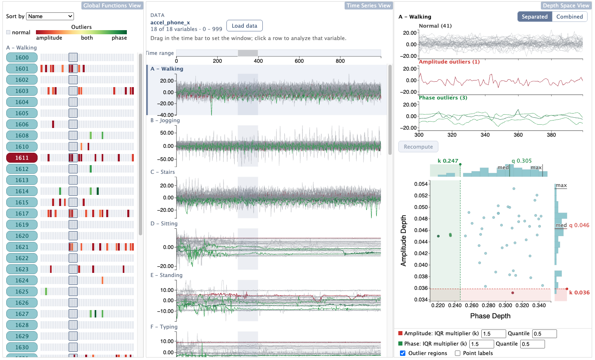

# ElasticVis



## About

Tool for visualizing/exploring anomalies in multivariate time series (MTS) data using elastic depth measures. Elastic depths are introduced in [1].

- Available in ``fdasrsf`` python package (https://fdasrsf-python.readthedocs.io/en/latest/)
- The source code can be found at [github.com/jdtuck/fdasrsf_python](https://github.com/jdtuck/fdasrsf_python).

Tested on macOS Sonoma, macOS Tahoe.

## Requirements

- Python 3.8–3.11
- Node.js (with npm)

## Datasets

1. [WISDM Smartphone and Smartwatch Activity and Biometrics Dataset](https://archive.ics.uci.edu/ml/machine-learning-databases/00507/WISDM-dataset-description.pdf) [2]
2. [HPC-ODA Dataset Collection](https://data.niaid.nih.gov/resources?id=zenodo_3701439) [3]

## Quick start

1. Add MTS data (.csv) to `server/data/`, in the format below
2. From the repository root, run: ``./start.sh``

The first run creates a Python virtual environment in `server/.venv` and installs the UI's npm packages, which takes a few minutes.

## Data format

Each dataset is one CSV file in `server/data/`

Every variable must have the same time points, in the same order. For example:

```csv
feature,timestamp,node0,node1,node2
cpu-cycles,2019-11-30 00:39:00,1.2e9,1.1e9,1.3e9
cpu-cycles,2019-11-30 00:40:00,1.4e9,1.2e9,1.3e9
col-idle,2019-11-30 00:39:00,7994,8072,7810
col-idle,2019-11-30 00:40:00,6120,6305,6011
```

Optionally, a `<name>.labels.json` file in `server/data/` gives variables display names (e.g. `A - Walking`) for the datasets it lists:

```json
{
  "datasets": ["accel_phone_x.csv", "gyro_phone_x.csv"],
  "labels": { "A": "Walking", "B": "Jogging" }
}
```

## References

[1] Harris, T., Tucker J. D., Li, B., Shand, L. (2020). Elastic Depths for Detecting Shape Anomalies in Functional Data. Technometrics, 63(4), 466–476. https://doi.org/10.1080/00401706.2020.1811156

[2] Weiss, G. M., Yoneda, K., Hayajneh, T. (2019). Smartphone and Smartwatch-Based Biometrics Using Activities of Daily Living. IEEE Access, 7, 133190-133202, https://doi.org/10.1109/ACCESS.2019.2940729

[3] Netti, A., Tafani, D., Ott, M., & Schulz, M. (2021). Correlation-wise Smoothing: Lightweight Knowledge Extraction for HPC Monitoring Data. Proceedings of the 35th IEEE International Parallel & Distributed Processing Symposium (IPDPS). IEEE. https://doi.org/10.1109/IPDPS49936.2021.00010
